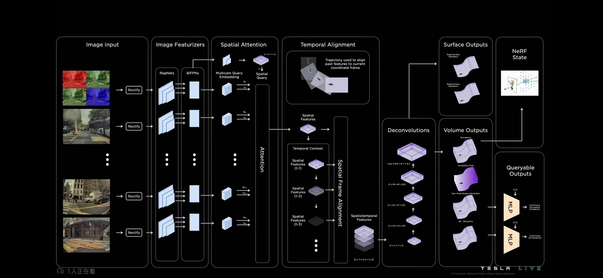
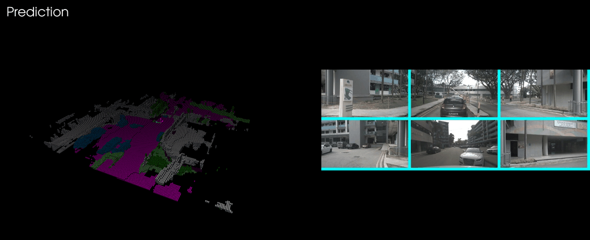
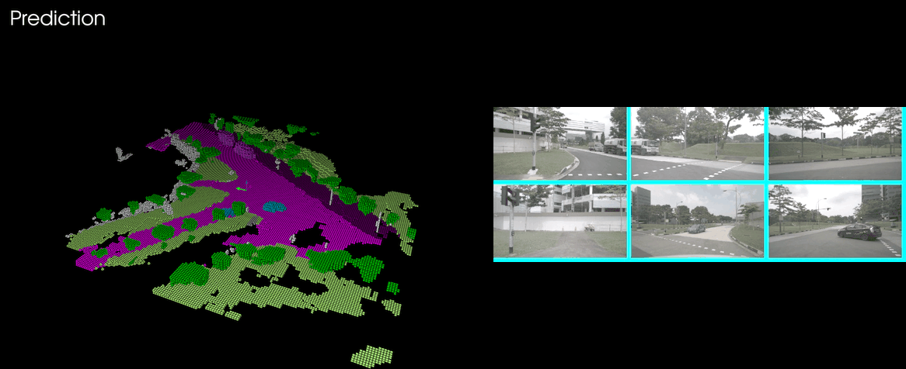
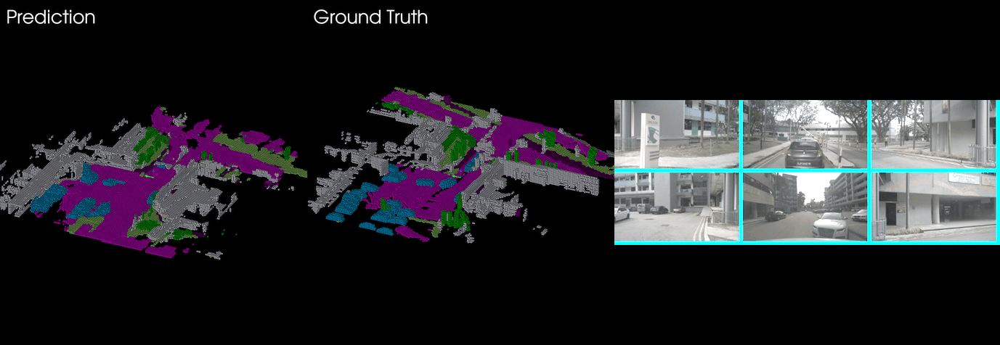
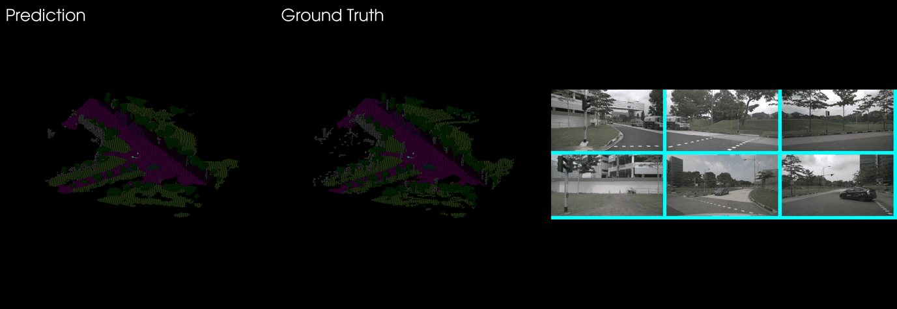

# DriveVisionOcc
It's a implementation of Tesla Occupancy network with optimized accerleration in spatial attention(source code is not opensoure now, when convinient it will opensource ). It is a single frame version, without temporal partition. Temporal version will upload in the coming future. DriveVisionOcc is trained on the nuScenes occupancy dataset and I haved provided a mini set.  
The prediction and the ground truth are shown as colored voxel grids; each voxel is 0.4m and colored by its semantic class.


# Performance
Testset and traiset resulted gifs are bellow. Testset seems unclear, but trainset is good, so the reason should be that the model need more data to train.

##  testset


##  trainset


##  testset compared with ground truth


## trainset compared with ground truth


# Quickstart
The code has been tested on Ubuntu 22.04. An anaconda virtual env is recommended:

```bash
conda create -n drivevisionocc python=3.11
conda activate drivevisionocc
```

And install the dependencies:

```
pytorch >= 2.1
open3d >= 0.16.0
opencv-python >= 4.7
pyvista
pillow
```
# Inference
Put the model file `DriveVisionOcc.pt` in the root directory of the repository, then run:

```bash
python test.py
```

to run the inference and display the prediction as a voxel grid. The results (`*_pred_occ.ply`, `*_gt_occ.ply`, `*_cams_source.jpg`) are saved under `pred_dir/`.

# Replay
The replays read their data from `pred_dir_testset_already/` and `pred_dir_trainset_already/`.  
Each sample is three files:

```
{idx}_pred_occ.ply     # predicted occupancy voxels (x, y, z + rgb)
{idx}_gt_occ.ply       # ground-truth occupancy voxels
{idx}_cams_source.jpg  # the corresponding camera image
```

Run one of the replays:

```bash
python pred_results_replay.py
python pred_results_replay_compare.py
```

Controls:

- mouse in the 3D window: rotate (left), pan (middle / shift+left), zoom (wheel)
- keys (focus the OpenCV "Image Window"):

| key | action |
| --- | --- |
| `space` | pause / resume |
| `i` | reverse the playback direction |
| `e` | toggle the cube edges |
| `w` | toggle wireframe (edges only) |
| `g` | toggle the ground-truth overlay (`pred_results_replay.py` only) |
| `r` | reset the camera to the default viewpoint |
| `q` / `ESC` | quit |


